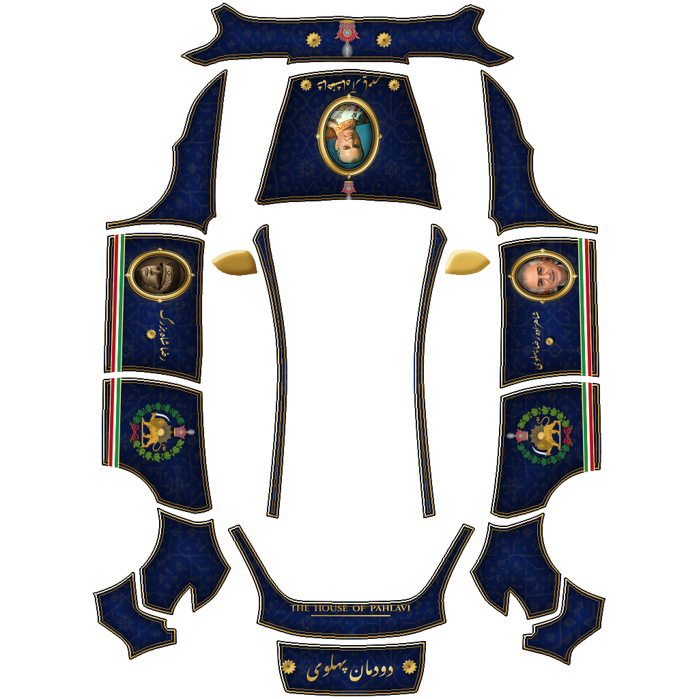
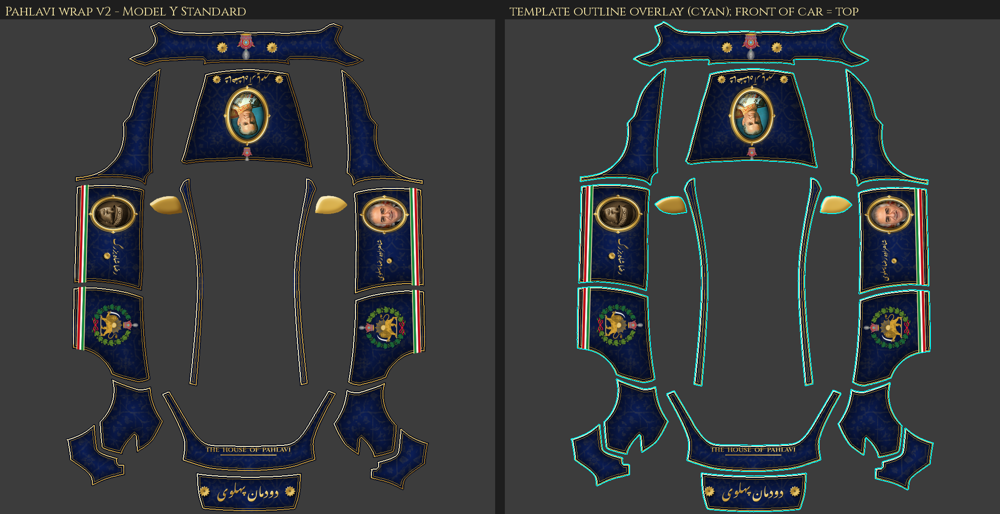
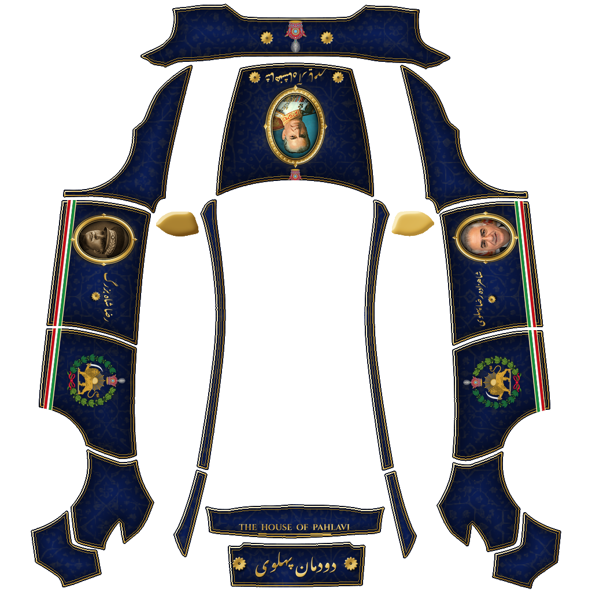
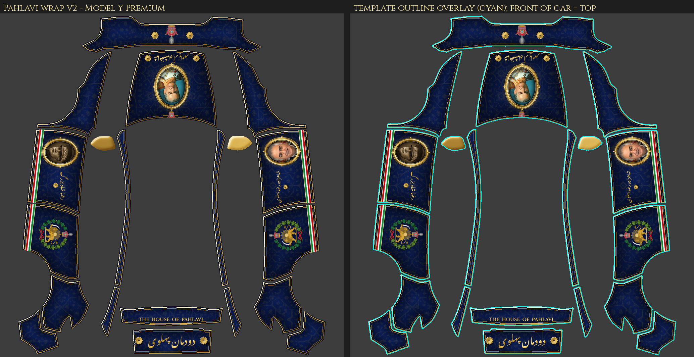
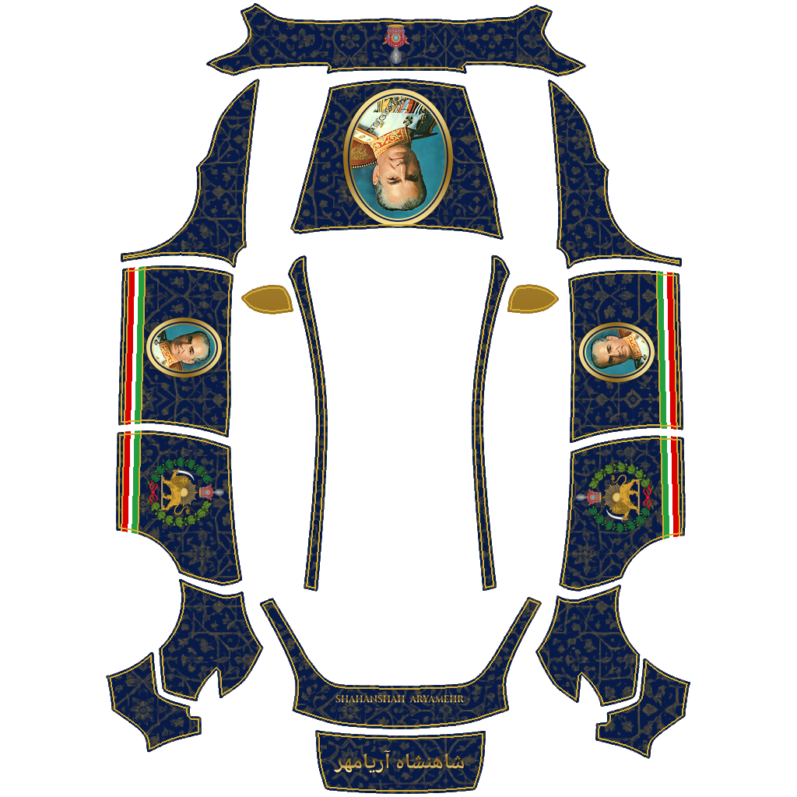
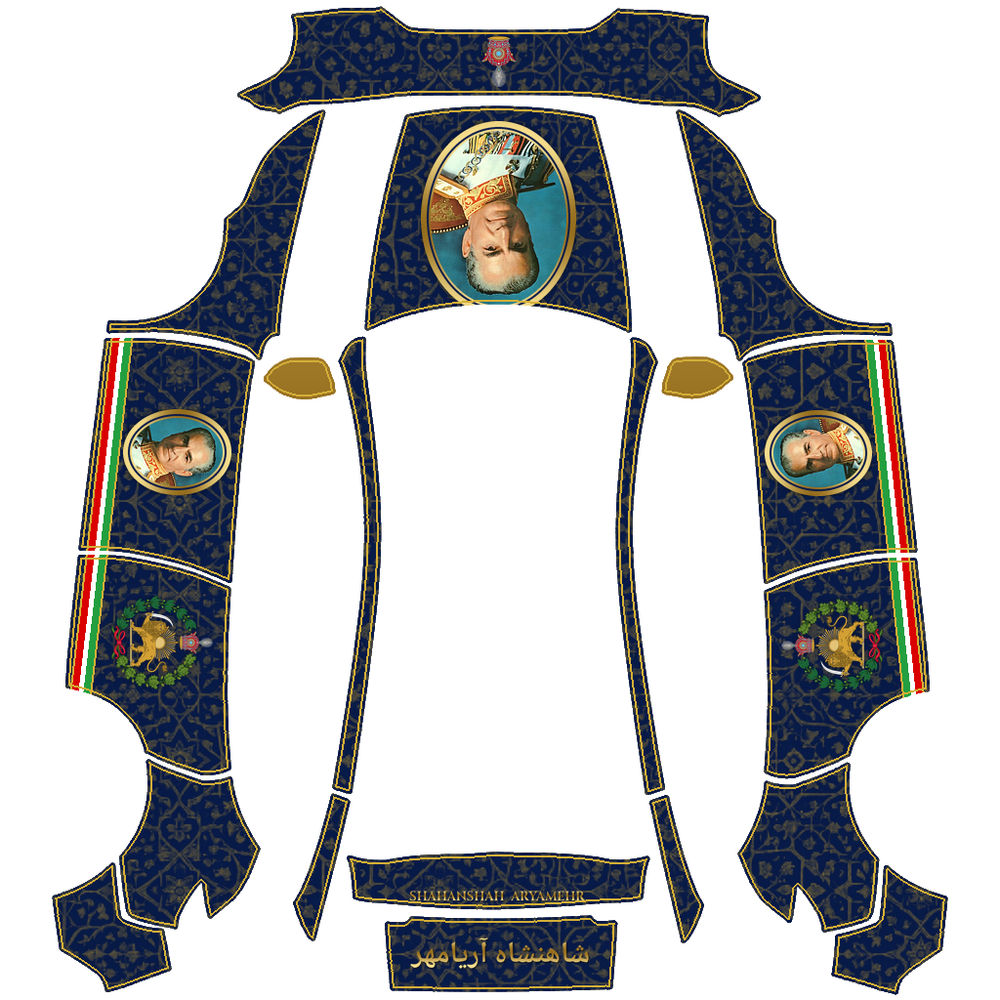

# رپ‌های پهلوی برای تسلا مدل Y (۲۰۲۶ RWD)

رپ‌های سفارشی Paint Shop به افتخار دودمان پهلوی، در رنگ‌های آبی سلطنتی و طلایی، با نشان شیر و خورشید و پرچم سه‌رنگ ایران.

*Pahlavi custom wraps for Tesla Model Y 2026 RWD (Paint Shop). Royal blue and gold, the Lion and Sun, and the Iranian tricolour.*

## کدام فایل برای خودروی شماست؟ / Which file do I use?

| فایل / File | نسخهٔ خودرو / Trim | قالب / Template |
|---|---|---|
| `Pahlavi_Standard.png` | مدل Y استاندارد / **Model Y Standard** | `modely-2025-base` |
| `Pahlavi_Premium.png` | مدل Y پریمیوم / **Model Y Premium** | `modely-2025-premium` |
| `Aryamehr_Standard.png` | مدل Y استاندارد (نسخهٔ اول) / Standard, v1 | `modely-2025-base` |
| `Aryamehr_Premium.png` | مدل Y پریمیوم (نسخهٔ اول) / Premium, v1 | `modely-2025-premium` |

> فایل استاندارد را فقط روی مدل استاندارد و فایل پریمیوم را فقط روی مدل پریمیوم استفاده کنید؛ قالب‌ها با هم فرق دارند.
> *Use the Standard file only on a Standard car and the Premium file only on a Premium car; the templates differ.*

## نسخهٔ ۲ — دودمان پهلوی / v2 — The House of Pahlavi

- **کاپوت:** محمدرضا شاه آریامهر در قاب بیضی طلایی، با تاج پهلوی و نوشتهٔ «شاهنشاه آریامهر»
- **درِ جلوی چپ:** رضا شاه بزرگ — **درِ جلوی راست:** شاهزاده رضا پهلوی
- **درهای عقب:** نشان شیر و خورشید
- **سپر جلو:** تاج پهلوی
- **عقب خودرو:** «دودمان پهلوی» به خط نستعلیق و THE HOUSE OF PAHLAVI

*Hood: Mohammad Reza Shah Aryamehr. Front doors: Reza Shah the Great (left) and Crown Prince Reza Pahlavi (right). Rear doors: Lion and Sun. Front bumper: Pahlavi crown. Rear: Persian and English lettering.*

### Pahlavi_Standard.png — Model Y Standard

 

### Pahlavi_Premium.png — Model Y Premium

 

## نسخهٔ ۱ — آریامهر / v1 — Aryamehr

| Aryamehr_Standard.png — Standard | Aryamehr_Premium.png — Premium |
|---|---|
|  |  |

## نصب / Install

**از راه اپ تسلا (نسخهٔ 4.59 یا بالاتر):**
۱. فایل PNG مناسب خودروی خود را روی گوشی دانلود کنید.
۲. در اپ تسلا: **Creations ← Wrap ← Upload**
۳. در خودرو: **Toybox ← Paint Shop ← Wraps**

*Tesla app v4.59+: Creations → Wrap → Upload, then in the car Toybox → Paint Shop → Wraps.*

**از راه فلش USB:**
۱. فلش را با فرمت exFAT یا FAT32 آماده کنید (NTFS پشتیبانی نمی‌شود).
۲. در ریشهٔ فلش پوشه‌ای به نام `Wraps` بسازید و فایل PNG را در آن بگذارید.
۳. فلش را به خودرو وصل کنید و بروید به **Toybox ← Paint Shop ← Wraps**.

*USB: format exFAT/FAT32, create a `Wraps` folder at the root, copy the PNG in, plug it into the car, then Toybox → Paint Shop → Wraps. The drive should not contain map or firmware update files.*

همهٔ فایل‌ها PNG، ۱۰۲۴×۱۰۲۴ و کمتر از ۱ مگابایت هستند. / *All files are 1024×1024 PNG, under 1 MB.*

## منابع و مجوزها / Credits & licences

همهٔ چهره‌ها عکس‌های واقعی‌اند؛ هیچ چهره‌ای با هوش مصنوعی ساخته نشده است. / *All faces are real photographs; no face was AI-generated.*

| بخش / Element | منبع / Source | مجوز / Licence |
|---|---|---|
| محمدرضا شاه (کاپوت) / Mohammad Reza Shah portrait, 1973 | [Wikimedia Commons](https://commons.wikimedia.org/wiki/File:Mohammad_Reza_Pahlavi_1973_portrait_(4x5_cropped).jpg), photo by Ghazarians | Public domain |
| رضا شاه بزرگ / Reza Shah in uniform, c. 1931 | [Wikimedia Commons](https://commons.wikimedia.org/wiki/File:Reza_shah_uniform.jpg), author unknown | Public domain; sepia-toned for the wrap |
| شاهزاده رضا پهلوی / Crown Prince Reza Pahlavi, 2023 | [Wikimedia Commons](https://commons.wikimedia.org/wiki/File:Crown_Prince_of_IRAN_Reza_PAHLAVI_(3x4_cropped).jpg) | Photo: Alain ROLLAND, © European Union 2023 – Source: EP. Reuse with attribution per the [European Parliament legal notice](https://www.europarl.europa.eu/legal-notice/) |
| شیر و خورشید و تاج / Lion and Sun emblem and crown | Imperial Coat of Arms of Iran by Sodacan, Wikimedia Commons | CC BY-SA 3.0 |
| خط نستعلیق / Noto Nastaliq Urdu font | Google Fonts | SIL Open Font License |
| Cinzel font | Google Fonts | SIL Open Font License |
| نقش زمینه و گل‌های تخت جمشیدی / Background ornament and rosettes | Made for this project (no faces) | — |

The derived emblem artwork is shared under CC BY-SA 3.0 as the original licence requires.

